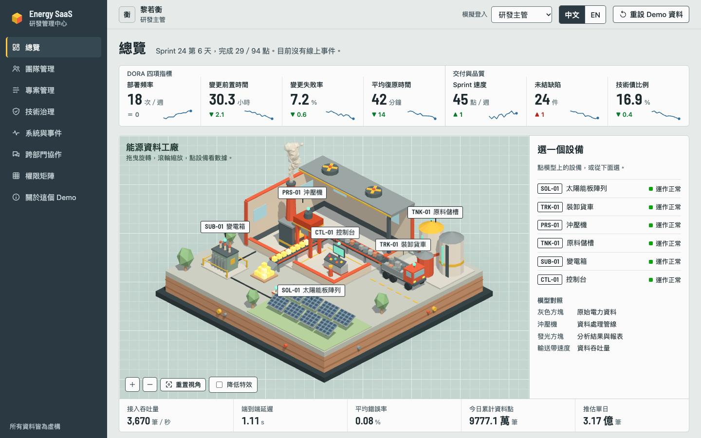

# Energy SaaS 研發管理中心

這是應徵能源 SaaS 研發主管（Software Engineering Manager）用的作品集 Demo，純前端。
內容是一支虛構的研發團隊：成員、專案、技術決策、工程指標，以及一個單日 3 億筆資料的時序資料平台。

**所有資料皆為虛構（mock data）。** 沒有後端，沒有 API 金鑰，也沒有任何真實公司、客戶或個人的資料。



## 功能

| 頁面 | 內容 |
| --- | --- |
| **總覽** | DORA 四項指標（部署頻率、變更前置時間、變更失敗率、MTTR）＋ Sprint 速度、缺陷數、技術債比例；近 12 週趨勢；Three.js 等距微縮「能源資料工廠」 |
| **團隊管理** | 8 位成員的負載（過高會警示）、技能雷達、OKR 進度、職涯目標、成長計畫、1:1 紀錄、績效回饋草稿；組織圖；招募漏斗 |
| **專案管理** | 專案列表與甘特圖；可拖曳的 Kanban；Sprint 容量與承諾點數、燃盡圖、每日站會；季度 OKR 與路線圖對齊圖 |
| **技術治理** | ADR 列表與詳情；Code Review 佇列；程式碼品質基準；技術債「影響 × 成本」矩陣；CI/CD Pipeline（失敗重跑、發版核准） |
| **系統與事件** | 資料平台架構圖（場站裝置 → 收集 → 串流 → 時序資料庫 → 分析 → 告警 → SaaS 報表）；每秒更新的即時模擬；線上事件流程與 Postmortem 範本 |
| **跨部門協作** | PM／CS 需求入口；需求評估（價值、工時、風險）並轉成工程任務；一鍵產生週報（Markdown，可複製） |
| **權限矩陣** | 角色 × 權限的 RBAC 表；管理員可直接修改，全站立即生效 |
| **關於這個 Demo** | 對應研發主管的哪些職責、研發流程圖、技術說明、3 分鐘導覽 |

### AI 協作展示（前端模擬，不呼叫 LLM）

- **AI 週報助理**：用規則與範本從目前的資料組出週報。在其他頁面移動任務或觸發事件後再產生，內容會跟著變。
- **績效回饋草稿**：從任務、技能與 1:1 紀錄列出事實，評語留給主管寫。
- **異常偵測**：對即時時序資料算 z-score，連續 2 筆超過 3 個標準差才算異常，3D 場景裡對應的設備會閃紅燈。

### 3D 能源資料工廠

- 切面底座上的低多邊形工廠：L 型輸送帶把「原料方塊」（原始電力資料）送進沖壓機（資料處理管線），出來變成「發光成品」（分析結果與報表）。
- 屋頂排風扇旋轉、煙囪冒煙、控制台按鈕閃爍；輸送帶速度跟著資料吞吐量變化。
- 拖曳旋轉、滾輪縮放（限制俯仰角，不會翻到底座下方）；點擊沖壓機、裝卸貨車、儲槽、太陽能板等設備，相機以 Lerp 平滑聚焦並顯示資料小卡。
- 線上事件期間，相關設備閃紅燈、煙霧變灰。
- 效能：方塊用 `InstancedMesh`；分頁不在前景或場景捲出畫面時暫停動畫；提供「降低特效」切換。

### 互動流程圖

架構圖、CI/CD Pipeline、事件處理流程、需求流程、OKR 對齊圖、組織圖與研發流程圖都用 [xyflow](https://github.com/xyflow/xyflow) 製作。
節點可以拖曳（版面會記住）、平移和縮放，節點上有即時數字與操作按鈕。
在 OKR 對齊圖上可以拉線，改變路線圖項目對齊的目標。

## 角色切換方式

頁面右上角的 **「模擬登入」下拉選單** 可以切換 5 種角色，選單與按鈕會跟著權限改變。
沒有權限的按鈕會顯示成上鎖，滑鼠移上去會說明缺少哪個權限。

| 角色 | 模擬人物 | 能做的事 |
| --- | --- | --- |
| 研發主管 | 黎若衡 | 看全部；指派任務、調整 OKR、核准發版、寫 1:1 紀錄、處理事件 |
| Tech Lead | 沈予安（資料平台組） | 管理所屬小組的任務、Code Review 決策、記錄 ADR、規劃 Sprint |
| 工程師 | 藍書緯 | 看自己的任務、更新狀態、填每日站會 |
| PM／CS | 溫芷寧 | 看路線圖、提需求、看事件狀態；不能改工程指派 |
| 管理員 | 系統管理員 | 管理成員與角色、編輯權限矩陣 |

右上角另有 **中文／EN** 語言切換，以及 **「重設 Demo 資料」** 按鈕。
所有操作都存在瀏覽器的 `localStorage`，重新整理後仍會保留；按「重設」會用固定的 seed 重建，結果每次都一樣。

## 本機啟動

需要 [bun](https://bun.sh)。

```bash
bun install
bun run dev        # 開發伺服器（預設 http://localhost:5173）
bun run build      # 型別檢查（tsc）＋ 正式建置，輸出到 dist/
bun run preview    # 預覽建置結果
```

也可以用 npm：`npm install && npm run build`。

## 測試

```bash
bun run check        # 型別檢查（含測試程式）＋ 單元測試
bun run test         # 只跑單元測試
bun run build && bun run test:e2e   # E2E 測試（會自己啟動預覽伺服器）
```

- **單元測試**（`tests/unit/`，用 `bun test`）：固定 seed 的亂數與假資料的決定性、z-score 異常偵測、負載與 Sprint 統計、RBAC 矩陣與權限判斷、兩份 i18n 字典是否一致、規則式的週報與範本、事件與 Pipeline 的狀態機、HTML 樣板的跳脫。
- **E2E 測試**（`tests/e2e/`，用 Playwright）：照驗收標準寫的，包含 5 種角色的選單與權限、Kanban 拖曳、重新整理後保留與重設、3D 點擊設備聚焦、事件走到事後檢討、需求轉任務、週報、CI/CD 流程。
- 本機的 E2E 直接使用已安裝的 Chrome 瀏覽器。沒有的話先執行 `bunx playwright install chromium`，再用 `CI=1 bun run test:e2e`。
- CI 的機器沒有 GPU，3D 場景靠軟體算圖。本機要重現同樣的情況：`E2E_SOFTWARE_GL=1 bun run test:e2e`。
- **資料來源的檢查**：單元測試確認網站的程式裡沒有任何網址，也沒有連線、Cookie 或定位的 API；E2E 走過每一頁，確認瀏覽器只向網站本身拿靜態檔案。
- **名稱查核**：`bun run check:names` 會從假資料取出所有組織名與人名，查有沒有剛好同名的真實公司或知名人物。來源是經濟部商工登記的公司登記（官方代碼表的 33 種狀態全查）與分公司登記、g0v 台灣公司資料（含商業登記）、GLEIF、Wikidata 與中文維基百科。約需 10 分鐘。假資料的名稱改了以後，單元測試會提醒重新查核。
- **Windows 檢查**：到 GitHub 的 Actions 頁面手動執行「Windows browser check」，會在 Windows 上對已部署的網站跑同一套 E2E，並上傳實際用到的字型清單與截圖。
- 同一套 E2E 可以對已部署的網站跑：`E2E_BASE_URL=https://<你的帳號>.github.io/<repo 名稱>/ bun run test:e2e`。

## 部署到 GitHub Pages

1. 把專案推到 GitHub（預設分支 `main`）。
2. 到 repo 的 **Settings → Pages**，把 **Source** 設為 **GitHub Actions**。
3. 之後每次推送到 `main`，`.github/workflows/deploy.yml` 會依序執行：安裝套件 → 型別檢查與單元測試 → 建置 → E2E 測試 → 部署 `dist/`。任何一步失敗就不會部署。
4. 完成後即可開啟 `https://<你的帳號>.github.io/<repo 名稱>/`。

**base 路徑**：`vite.config.ts` 的 `base` 預設是相對路徑 `./`，路由用 hash（`#/dashboard`）。
repo 換名字或放在別的子路徑都能開啟，重新整理也不會 404。
若要改用絕對路徑，建置時指定 `VITE_BASE=/your-repo/ bun run build` 即可。

## 資料夾結構

```
├── .github/workflows/
│   ├── deploy.yml                 測試通過後自動部署
│   └── windows-check.yml          手動執行的 Windows 檢查
├── docs/
│   ├── demo-script.md             3 分鐘 Demo 腳本
│   └── screenshots/               截圖
├── index.html
├── vite.config.ts                 base 設定
├── playwright.config.ts           E2E 測試設定
├── bunfig.toml                    bun test 設定
├── tests/
│   ├── unit/                      單元測試（bun test）
│   └── e2e/                       E2E 測試（Playwright）
├── scripts/                       假名稱查核（check-names.ts）
└── src/
    ├── main.ts                    進入點
    ├── core/                      型別、store（localStorage）、RBAC、i18n、路由、推導資料、事件與 Pipeline 狀態機
    ├── i18n/                      zh.ts／en.ts 字典（en 少一個 key，tsc 就會報錯）
    ├── mock/                      假資料：members、projects、tasks、sprints、okrs、adrs、incidents、metrics、devices…與 seeded RNG
    ├── sim/                       即時模擬引擎與 z-score 異常偵測
    ├── ai/                        規則式的週報、回饋草稿、Postmortem 範本
    ├── three/                     3D 場景（scene.ts 建模、factory.ts 互動與動畫）
    ├── flow/                      互動流程圖（xyflow 的 React 島）
    ├── ui/                        外殼、共用元件、圖表封裝、延遲載入
    ├── pages/                     各頁面
    └── styles/main.css            設計代碼與樣式
```

## 截圖位置

截圖放在 [`docs/screenshots/`](docs/screenshots/)：

| 檔案 | 畫面 |
| --- | --- |
| `01-dashboard.png` | 總覽與 3D 能源資料工廠 |
| `02-device-focus.png` | 點擊設備後的聚焦與資料小卡 |
| `03-team.png` | 團隊管理 |
| `04-kanban.png` | Kanban |
| `05-sprint.png` | Sprint 與燃盡圖 |
| `06-incident.png` | 事件處理流程 |
| `07-cicd.png` | CI/CD Pipeline |
| `08-okr.png` | OKR 對齊圖 |

## Demo 腳本

請見 [`docs/demo-script.md`](docs/demo-script.md)：
Dashboard → 3D 點擊設備 → 團隊 1:1 → Sprint 與 Kanban → 模擬事件與 Postmortem → AI 週報。

## 技術

- **Vite + TypeScript**：介面沒有用框架，每頁各自切成獨立 chunk。
- **Three.js**：`OrthographicCamera`、`InstancedMesh`、`OrbitControls`、`Raycaster`。
- **Chart.js**：趨勢圖、燃盡圖、雷達圖、即時折線圖。
- **xyflow（React Flow）**：互動流程圖，進到有流程圖的頁面才載入。
- **無障礙**：鍵盤可操作（3D 設備標籤、Kanban 卡片的箭頭按鈕）、可見的焦點框、`prefers-reduced-motion` 時預設降低特效。

## 聲明

本專案中的公司、客戶、場站、成員、指標、事件與任務都是虛構的，沒有任何一筆來自真實的公司、客戶或個人。
名稱如果剛好與真實的公司或人物相同，純屬巧合。
